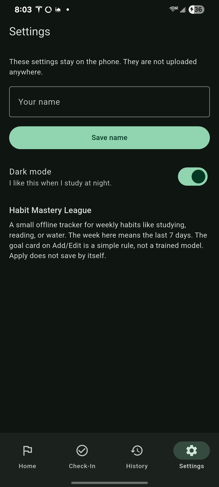

# Habit Mastery League

This app help students keep a weekly habit, like studying, reading, or drinking water. You add the habit, check in on the days you finish, and look at the history later. It work without internet.

Team: Abubeker Mohammed (github.com/abubekerm1) and Jalen Artis (github.com/jaiix2)
Class: Mobile Application Development, Project 1, undergraduate, Fall 2026

How we split the work:
- Abubeker Mohammed: Home, Add/Edit, SQLite, and the proposal
- Jalen Artis (github.com/jaiix2): Check-In, History, Settings, and the goal helper
- Both of us: testing and the write-ups

## What the app does
- Add, edit, and delete a habit
- Save, update, and delete a check-in
- Start a week, finish it, or reset the last 7 days
- Filter history by category and see a completion rate
- Save a name and dark mode on the phone

## Screens
1. Home, the habit list
2. Add / Edit habit (you open this from Home)
3. Check-In
4. History
5. Settings

The bottom menu is Home, Check-In, History, and Settings.

## How to run it
We used Flutter 3.47.3. This project is Android only.

```bash
flutter pub get
flutter test
flutter run
```

Plug in an Android phone and turn on USB debugging. Pick that phone when Flutter asks. I edit the Dart files in VS Code.

Packages: sqflite, path, path_provider, and shared_preferences.

## Links
GitHub: https://github.com/abubekerm1/habit_mastery_league

ClickUp board: https://app.clickup.com/90141776119/v/b/2kydwp7q-414

ClickUp write-up: `Kanban_Contribution_Evidence.pdf` in this folder. The board pictures in it are from October 16, when we were still planning. I did not take new board pictures on October 20, October 23, or October 27.

## Data on the phone
The SQLite file is `habit_league.db`.

habits
- id, name, category, weekly_goal, is_active

checkins
- id, habit_id, checkin_date, completed, note

habit_id points at a habit. If you delete a habit, its check-ins go too. I turn foreign keys on, and I also delete the check-ins in the same step.

One habit cannot have two check-ins on the same day. If you save that day again, it updates the old row.

SharedPreferences is only for small settings:
- display_name
- dark_mode
- sample_habits_added, so the sample habits do not come back after you delete all of them

No cloud database. The goal card is a rule on the phone, not an online helper.

The first time the database is empty, three sample habits get added so the list is not blank.

## Goal card
On Add/Edit there is a card that suggest a weekly goal from the check-ins in the last 7 days. It is a rule I wrote, not a trained model. Apply only move the slider. The habit is not saved until Save. Not now hide the card until you leave the screen.

The fixed starter goal is 3 days. More detail is in AI_FEATURE.md. How the files are split is in ARCHITECTURE.md.

## Dark mode
The switch is on the Settings screen. I turned it on from the phone, and it stay saved after the app close.



## Known limits
- A week here is the last 7 days, not Monday to Sunday.
- One or two check-ins can make the suggestion jump up too fast. The card say when that happen.

## Later
A phone reminder for a habit would help. We did not add that yet.

## License
This is school work for our team. Please do not turn it in as your own.

YouTube Project Presentation: https://youtu.be/zTOYwQ9QCCY
